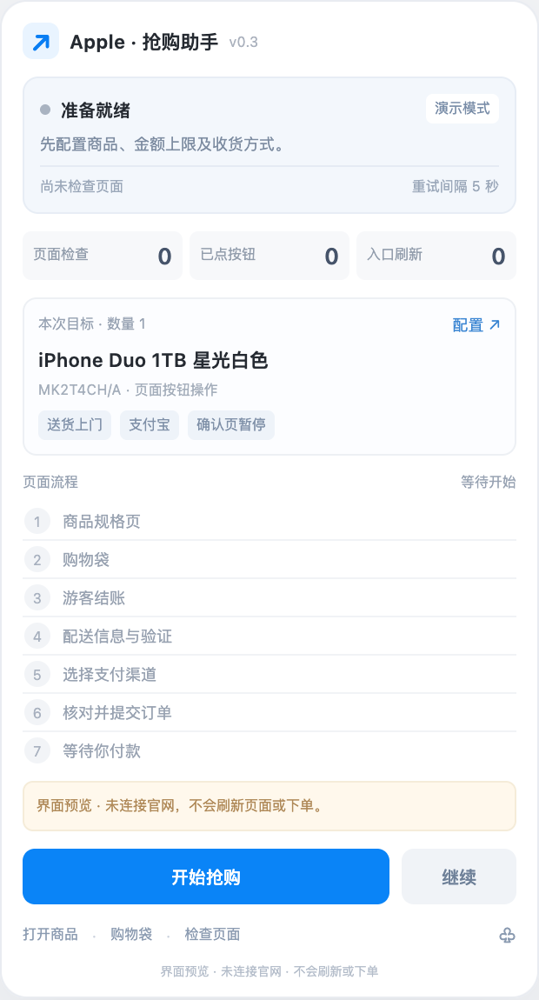
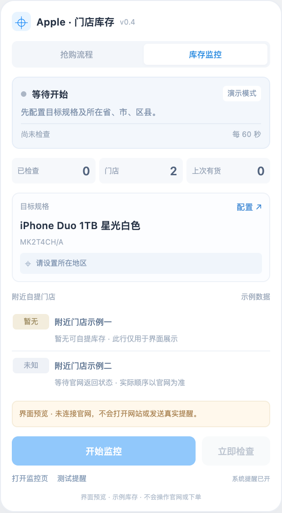
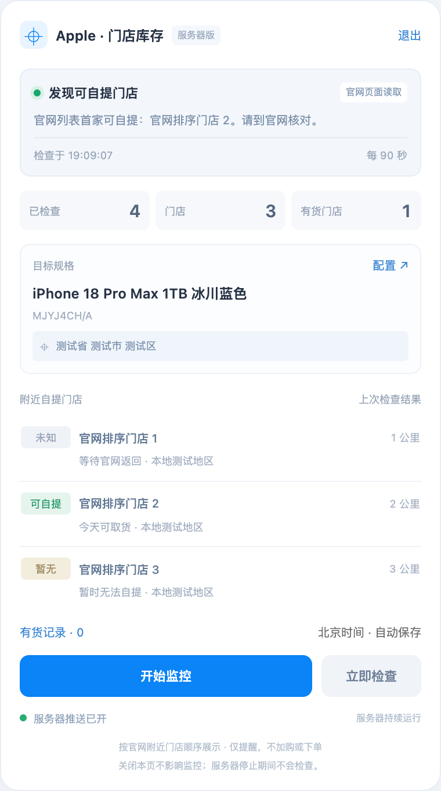

# Apple · 页面抢购助手 v0.4

Chrome / Edge 浏览器扩展原型。使用官网页面的按钮、表单和页面状态完成购买流程，右侧显示可收起的小悬浮面板。**本版不直接请求库存接口，也不拼接下单接口。** 官网在正常加载页面、点击按钮时自身产生的网络请求仍然存在。

本项目为独立开发的非官方工具，与 Apple 无隶属关系。





## 使用前先看

官网游客购买流程已人工验证到「订单正在等待付款」，使用的是 iPhone 18 Pro Max 1TB 冰川蓝色；付款没有执行。**插件自己的全程自动执行仍需在实际安装后验证**，本地浏览器测试采用构造页面，不能证明在未来开售时一定可用。

v0.4 门店监控已在实际安装的 Chrome 扩展中验证：根据配置在后台打开商品页、选择上海徐汇区并读取 10 家附近门店的距离和取货状态，同一后台页面连续两轮查询与暂停均已验证。该验证使用 iPhone 18 Pro Max 1TB 冰川蓝色，未加购或下单。其余规格和官网改版后的页面仍以实际检查结果为准。

## 独立服务器监控

门店库存现可独立运行在服务器，不依赖本机扩展。提供 Docker 部署、密码管理页、持久化、重启恢复和可选 Webhook 通知；购买流程仍在原扩展中。详见 [服务器部署说明](server/README.md)。



服务器管理页预览使用本地示例数据。

## 安装

1. 解压文件，保留整个 `apple-stock-assistant` 文件夹。
2. Chrome 打开 `chrome://extensions`，Edge 打开 `edge://extensions`，开启「开发者模式」。
3. 选择「加载已解压的扩展程序」，选择包含 `manifest.json` 的文件夹。
4. 打开或刷新苹果中国官网，右侧会显示小面板；也可固定扩展图标打开同一面板。
5. 点击「配置」，选择商品、收货方式、付款渠道和重试间隔。需要自动提交订单时，填写总额上限并勾选允许提交。

从 GitHub 下载时，可使用「Code → Download ZIP」解压，再选择项目根目录。插件本身无需安装 Node.js 或运行构建命令。

升级已安装版本时，将新版本文件覆盖到原来加载的扩展目录，在扩展管理页点击「重新加载」，然后刷新官网标签页。原有抢购设置和库存监控设置分别保存在本机。

抢购流程执行时保持插件打开的官网标签页在前台可见；购买按钮点击前会检查页面可见性。悬浮面板在执行点击时会临时隐藏，避免遮挡官网按钮，点击结束后恢复。库存监控使用独立的商品标签页，可在后台检查页面。

直接打开 `panel.html` 是可交互的界面预览，**不会打开官网、刷新真实页面或下单**。

## 附近门店自提库存监控

1. 在小面板顶部切换到「门店库存」，点击「配置」。
2. 选择商品预设，或填写完整商品规格名称、SKU 与对应的官网商品链接。 白色 Duo 512GB 可使用自定义规格「iPhone Duo 512GB 星光白色」、`MK2P4CH/A` 和 `https://www.apple.com.cn/shop/buy-iphone/iphone-duo/mk2p4ch/a`。
3. 填写当前位置的省、市、区县；无需门牌号。官网如果提供邮编输入框，也可使用其支持的邮编。遇到无法解析的位置选择器时，会暂停并提示在官网手动处理。
4. 设置检查间隔（30–3600 秒，默认 60 秒）、最多展示的附近门店数与到货提醒，然后开始监控。
5. 列表显示官网返回的附近门店顺序、官网提供的距离和取货文案。有货时可打开查询页自行选店购买。

监控通过官网的「供货情况」弹窗选择位置并读取可见门店列表，使用独立的标签页与本机设置；不会加购、提交订单或触发原抢购流程，也不直接请求库存接口。仅以门店行明确的取货状态判断有货或无货，无法识别时显示「待确认」。门店距离与排序由官网提供，未做地图定位或路线距离计算；只覆盖官网返回并展示的门店。

第一次发现可自提，或某家店明确从无货恢复有货时，发送系统通知。同一门店持续有货不会重复提醒；网络失败或状态未知也不会当作「先无货、后到货」反复通知。检查失败时保留上次成功结果并标记过期。浏览器关闭、电脑休眠或网页被冻结时不能保证准时检查，请保持 Chrome / Edge 运行并保留监控标签页。

位置仅保存在本机，用于填入 Apple 官网的查询控件；不会上传到 GitHub，也不调用地图服务。遇到登录、验证码或隐私确认会暂停。监控与购买流程互相独立，可分别暂停。

## 已内置的页面流程

商品规格页 → 添加到购物袋 → 查看购物袋 → 结账 → 游客结账 → 收货方式 → 送货信息与手机验证 → 支付渠道 → 检查订单 → 核验并提交 → 待付款停止。

- 默认目标：iPhone Duo 1TB 星光白色，`MK2T4CH/A`。
- 测试预设：iPhone 18 Pro Max 1TB 冰川蓝色，`MJYJ4CH/A`。
- 购买数量固定为 1。默认不允许提交订单，确认页会等待你处理。
- 支持送货模式；自提的门店与时段需要在官网手动选择。
- 可选收货资料保存在本机扩展存储，仅用于填入官网表单。默认值全部为空，代码与安装包不包含本次测试的个人资料。复杂地区控件或不明确的表单会暂停。
- 手机验证码、账号登录、人机验证和隐私/条款确认需要你在官网完成，完成后点插件「继续」。付款由你完成。
- 在同一浏览器用户配置中提前登录后，官网若跳过登录页，插件会直接跟随进入结账。若登录失效又出现登录页，当前版本会尝试游客结账；没有强制使用已登录账号的开关。官网已带出收货资料时，可留空插件中的可选收货信息。

## 页面打不开和刷新

插件先判断当前页与下一步按钮，再决定等待、点击或暂停。等待间隔可设为 **3–30 秒**；入口刷新次数 **0 表示不限**，其他值限制在 1–300 次。

只有尚未发生加入购物袋等操作、可以确认是只读商品入口时，才自动刷新入口继续等待。Chrome 网络错误导致内容脚本无法运行时，也由后台按同一约束重试。浏览器后台调度、休眠可能延迟重试，不保证精确到秒。

加入购物袋或提交订单后，若点击结果无法确认，插件会停止继续派发同一动作，并重新检查页面；不会为了重试而盲目重加购物袋或重复提交订单。验证码、登录或条款提示也会暂停。**这不是对所有结账页无限刷新。** 后续无法确认状态的页面需要你检查，再点「继续」。

## 订单核验与停止

提交前检查金额上限、数量和商品身份。通常要求页面可见的完整 SKU；对上面两个已核验的预设，也可在 Review 阶段的唯一商品行中核对完整机型、容量、颜色、明确数量及金额。额外商品、金额不一致、无法唯一定位的按钮都不会自动提交。

插件只允许在账单阶段选择支付宝/微信支付渠道；实际付款按钮和支付站点不会自动操作。识别官网的有效订单编号与待付款文案后停止。

「暂停」停止自动操作。「继续」检查当前标签和步骤，不会无条件从头开始。后台重启、标签关闭或结果不确定时保留状态并暂停，避免重复订单。已识别待付款后，面板会显示「新任务」：只重置本机流程，不清除官网购物袋或订单，也不会立即开始；请先核对旧订单，再配置下一次购买。结果不确定的中途任务不能直接重置后重放。

## 权限与验证范围

权限包括本机存储、浏览器调度、系统提醒及苹果中国官网页面访问；不读取账号密码、验证码或付款资料，没有外部统计服务。

开发测试使用 Node.js 20 或更新版本。在项目根目录运行：

```sh
npm ci
npx playwright install chromium
npm test
```

测试覆盖配置、页面按钮和阶段识别、重试调度、暂停恢复、防重复行为，以及门店列表识别、位置切换、库存变化提醒与暂停后的取消。浏览器测试只加载本地构造页面，拦截外部网站请求，不会访问真实账号或创建订单。界面测试截图输出到被 Git 忽略的 `test-artifacts/`。

未安装开发依赖时，也可运行 `node --test tests/*.test.mjs` 执行无依赖测试；对应的浏览器测试会跳过。只有完整测试没有跳过项目时，才算验证了浏览器构造页面中的流程。

Chrome 的后台脚本可能被休眠；本版同时使用页面计时与恢复调度。[Chrome 后台说明](https://developer.chrome.com/docs/extensions/develop/concepts/service-workers/lifecycle) · [Chrome 调度说明](https://developer.chrome.com/docs/extensions/reference/api/alarms) · [加载本地扩展](https://developer.chrome.com/docs/extensions/get-started/tutorial/hello-world#load-unpacked)
